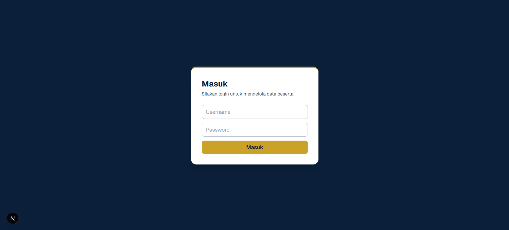
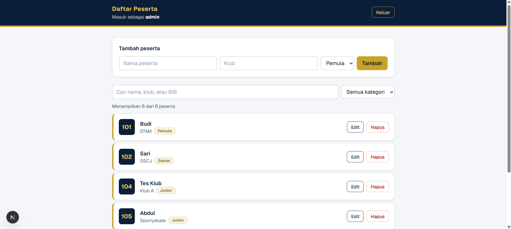

# Participant Manager




A small full-stack app for managing event participants, built to practice
modern web development after years of CodeIgniter 3.

## Features

- Login/logout with signed, httpOnly session cookies
- Create, edit, delete participants (name, club, category, auto-generated BIB)
- Search by name, club, or BIB, and filter by category
- Server-side validation and authentication on every API route

## Tech stack

- Next.js (App Router), React, TypeScript
- Tailwind CSS
- MySQL (`mysql2`, prepared statements)
- `bcryptjs` for password hashing, `jose` for session tokens

## Getting started

1. Install dependencies

   ```bash
   npm install
   ```

2. Create the database: run `db/schema.sql` in MySQL.

3. Copy `.env.example` to `.env.local` and fill in the values.
   Generate a session secret with:

   ```bash
   node -e "console.log(require('crypto').randomBytes(32).toString('hex'))"
   ```

4. Create an admin user. Generate a hash, then insert it:

   ```bash
   node -e "console.log(require('bcryptjs').hashSync('your-password', 10))"
   ```

   ```sql
   INSERT INTO users (username, password_hash) VALUES ('admin', '<paste hash>');
   ```

5. Run the app

   ```bash
   npm run dev
   ```

   Open http://localhost:3000 and log in.

## Notes

- Data is loaded on the server (Server Component); the interactive list is a
  Client Component.
- Never commit `.env.local`.
